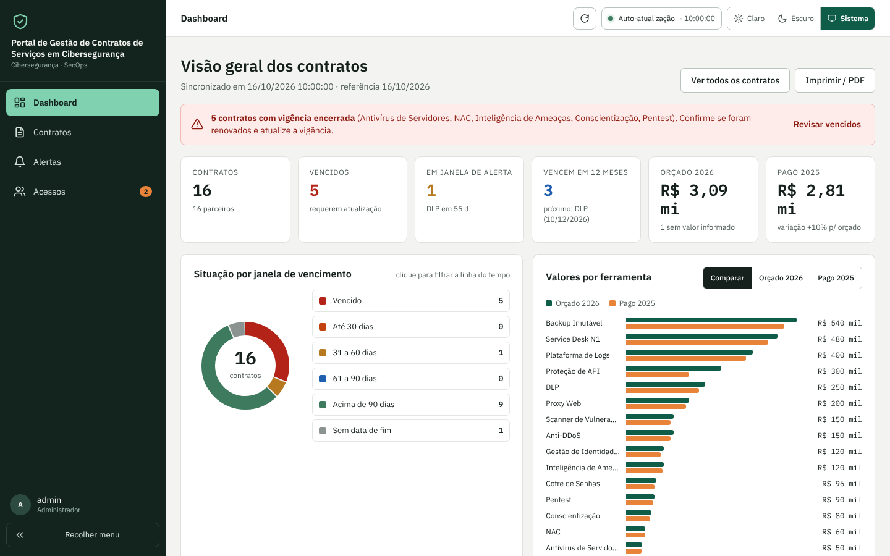
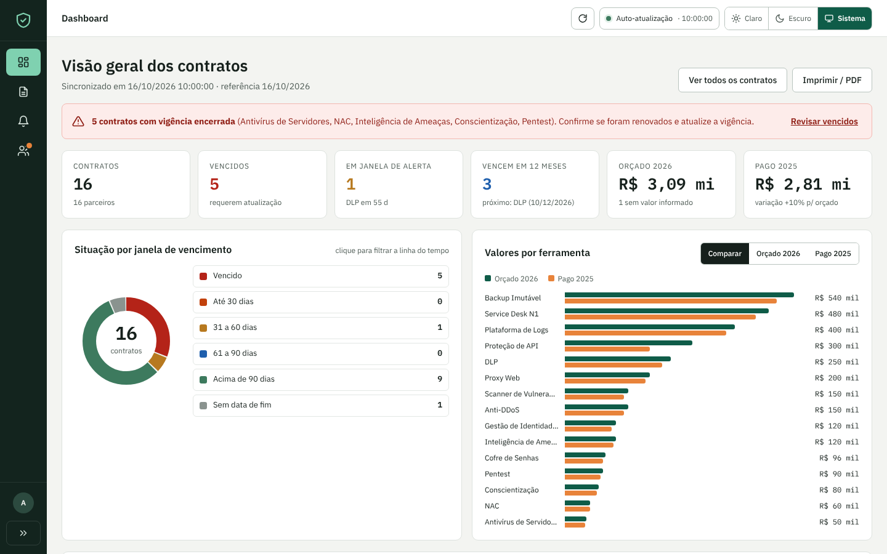
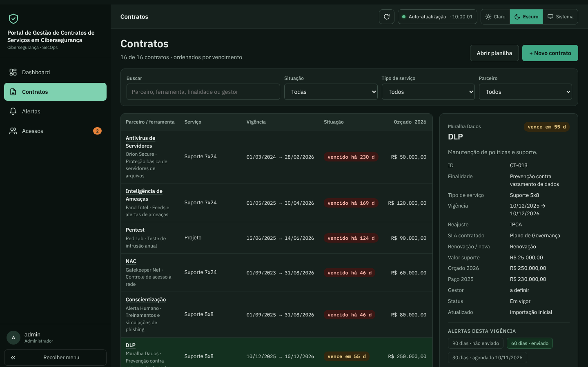
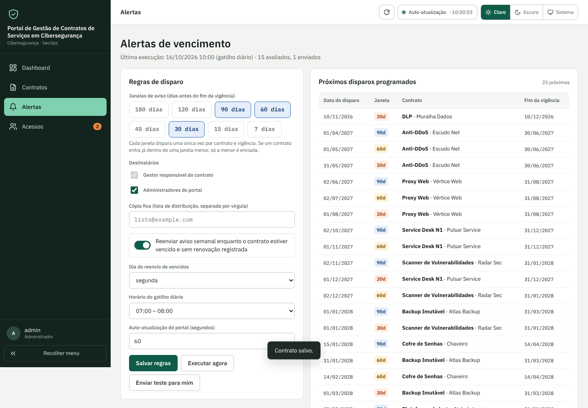
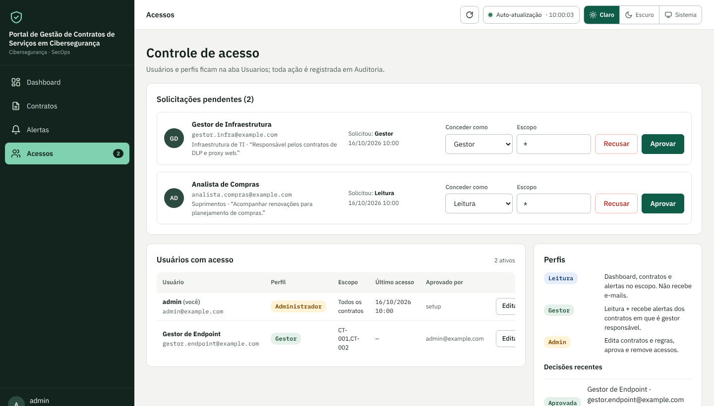
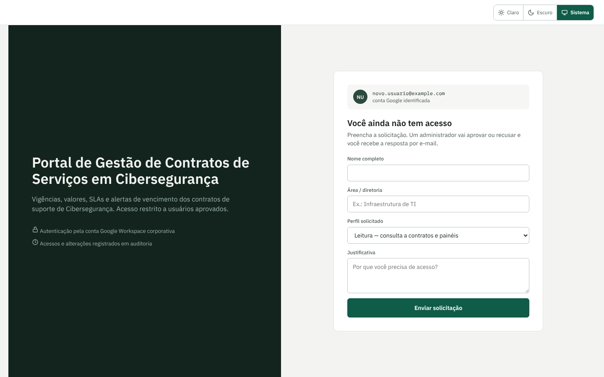
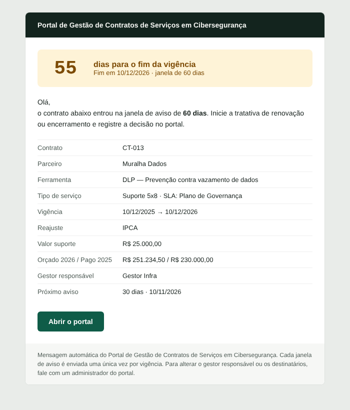
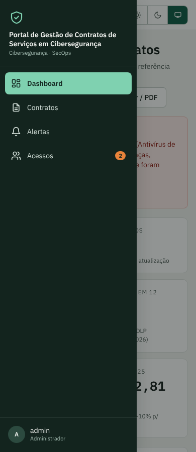

# Portal de Gestão de Contratos de Serviços em Cibersegurança

Portal web em **Google Apps Script + Google Planilhas** para equipes de Cibersegurança/SecOps acompanharem contratos de suporte e serviços (MSS, licenças, suporte 24x7). O portal tem dashboard para gestores, controle de acesso com aprovação e **alertas automáticos por e-mail 90, 60 e 30 dias antes do fim da vigência**.

Não depende de servidor, banco de dados ou licença extra: roda inteiro dentro do Google Workspace.

> Os dados deste repositório (empresas, ferramentas, valores e pessoas) são **fictícios**.



## Funcionalidades

- **Dashboard**: indicadores, situação por janela de vencimento (clique filtra a linha do tempo), valores orçados x pagos por ferramenta, linha do tempo das vigências, próximos vencimentos e últimos alertas.
- **Contratos**: busca, filtros, painel de detalhe e, para administradores, edição, **registro de renovação** (reinicia o ciclo de alertas) e exclusão.
- **Alertas 90/60/30**:
  - gatilho diário, com cada janela enviada **uma única vez** por contrato e vigência;
  - reenvio semanal opcional para contratos vencidos;
  - histórico de envios, próximos disparos, execução manual e e-mail de teste.
- **Controle de acesso com aprovação**:
  - o próprio usuário solicita acesso e o administrador aprova (perfil e escopo) ou recusa (com motivo);
  - administradores editam e removem usuários;
  - toda ação vai para a auditoria.
- **Perfis**:
  - `Leitura`: consulta o portal;
  - `Gestor`: consulta e recebe os alertas dos seus contratos;
  - `Administrador`: acesso total.
- **Escopo por contrato**: `*` libera todos; uma lista de IDs (`CT-001,CT-013`) restringe a visão.
- **Temas**: claro, escuro ou do sistema, lembrados por usuário.
- **Sidebar** expansível e recolhível; no celular vira gaveta.
- **Auto-atualização**: o portal recarrega sozinho quando os dados mudam, seja pelo portal ou por edição direta na planilha.

| Sidebar recolhida | Tema escuro |
|---|---|
|  |  |

| Alertas | Gestão de acessos |
|---|---|
|  |  |

| Solicitação de acesso | E-mail de alerta | Celular |
|---|---|---|
|  |  |  |

## Arquitetura

```
Navegador (HtmlService, iframe sandbox)
   │  google.script.run
   ▼
Apps Script (src/Code.gs) ── executa como o dono do script
   │   • autenticação: Session.getActiveUser() (conta do domínio)
   │   • autorização: perfil + escopo, validados em TODA função pública
   │   • LockService nas escritas, auditoria de todas as ações
   ▼
Google Planilhas: Contratos · Usuarios · Solicitacoes · LogAlertas · Auditoria · Config
   ▲
Gatilhos: runDailyAlerts (diário) · onDataChange (onEdit/onChange → versão dos dados)
```

A **auto-atualização** funciona assim:
- toda escrita, pelo portal ou por edição direta na planilha (gatilhos `onEdit`/`onChange`), grava um novo `DATA_VERSION` em `ScriptProperties`;
- o cliente consulta `getVersion()` no intervalo configurado e recarrega quando a versão muda;
- a autorização dessa consulta fica 2 minutos em cache para a verificação ser barata;
- a consulta pausa enquanto a aba do navegador estiver oculta.

## Instalação

1. Suba `data/planilha-base-exemplo.xlsx` no Drive e use **Arquivo > Salvar como Planilhas Google**. Também é possível começar de uma planilha vazia, porque o `setup()` cria as abas.
2. Na planilha, abra **Extensões > Apps Script** e crie os arquivos de `src/` com os mesmos nomes.
   - **Script:** `Code`, `Logo`.
   - **HTML:** `Index`, `Styles`, `Scripts`, `Email`.
   - **Manifesto:** substitua o `appsscript.json`. Para vê-lo no editor, ative a opção em *Configurações do projeto*.
3. Execute a função **`setup`** e autorize. Ela cria as abas e colunas que faltarem, a configuração padrão, o primeiro administrador (quem executou) e os 3 gatilhos.
4. **Implantar > Nova implantação > App da Web**:
   - *Executar como:* **Eu**;
   - *Quem pode acessar:* **qualquer pessoa no seu domínio**.
5. Em `Config`, ajuste `DOMINIO_PERMITIDO` para o seu domínio e, se quiser, `CC_FIXO`, janelas e horário.
6. Preencha `gestor_email` nos contratos: é para esse e-mail que o alerta vai.

### Com clasp (opcional)

```bash
npm i -g @google/clasp && clasp login
clasp create --type sheets --title "Portal de Contratos" --rootDir src
clasp push
```

### Logo da organização

O portal mostra um escudo neutro por padrão. Para usar o seu logo (versão para **fundo escuro**), escolha uma das opções:
- cole o PNG em base64 em `src/Logo.gs`;
- informe o ID de um arquivo do Drive em `Config > LOGO_FILE_ID`.

## Configuração (aba `Config`)

| Chave | Padrão | Descrição |
|---|---|---|
| `JANELAS` | `90,60,30` | Dias antes do fim da vigência em que o alerta é enviado |
| `NOTIFICAR_ADMINS` | `SIM` | Copiar administradores nos alertas |
| `CC_FIXO` | — | Lista de distribuição sempre copiada |
| `REENVIO_VENCIDOS` | `SIM` | Aviso semanal enquanto o contrato estiver vencido |
| `DIA_REENVIO` | `1` | Dia do reenvio (1 = segunda … 7 = domingo) |
| `HORA_GATILHO` | `7` | Hora do gatilho diário |
| `AUTO_REFRESH_SEGUNDOS` | `60` | Intervalo de verificação de novos dados (mín. 15) |
| `LOGO_FILE_ID` | — | Logo no Drive (opcional) |
| `ROTULO_ORCADO` / `ROTULO_PAGO` | `Orçado 2026` / `Pago 2025` | Rótulos das colunas de valor |
| `DOMINIO_PERMITIDO` | `example.com` | Domínio autorizado a solicitar acesso |

## Regras dos alertas

- Para cada contrato com data de fim e status diferente de `Encerrado`, o motor identifica a **menor janela** que contém os dias restantes. Um contrato cadastrado com 20 dias para vencer recebe só o aviso de 30.
- Cada envio é registrado em `LogAlertas` com a chave `contrato|fim|janela`. **Registrar uma renovação** (novo fim) reinicia o ciclo.
- Falhas ficam com status `Erro` e são tentadas de novo no ciclo seguinte. A cota do MailApp é verificada antes de cada envio.
- **Destinatários:** o gestor do contrato fica no *Para*; administradores e a cópia fixa, no *Cc*. Sem gestor, o primeiro administrador vira o destinatário principal.

## Segurança

- Toda função pública do servidor revalida identidade e perfil. Funções terminadas em `_` são privadas no Apps Script.
- Os gatilhos verificam se o `triggerUid` pertence a um gatilho real do projeto, e não a uma chamada forjada via `google.script.run`.
- Textos vindos do navegador são neutralizados contra **injeção de fórmula** (`=`, `+`, `-`, `@`) antes de ir para a planilha.
- Escape de HTML em toda saída, `XFrameOptionsMode.DEFAULT` (anti-clickjacking) e `LockService` nas escritas.
- Ninguém remove o próprio acesso, nem remove ou rebaixa o último administrador.
- Para embutir no Google Sites, troque para `ALLOWALL` em `doGet()` consciente do trade-off.

## Testes

Os testes rodam o **código real de `src/`** sobre mocks dos serviços do Apps Script: planilha, MailApp, gatilhos, cache, propriedades e lock.

```bash
npm install
npm test          # backend: 46 verificações (permissões, alertas, idempotência, renovação, auto-refresh…)
npm run test:ui   # interface no Chromium: temas, sidebar, filtros, acessos, auto-refresh, mobile
```

As capturas de tela ficam em `tests/out/shots` (ou na pasta indicada em `SHOTS`). Para regenerar a planilha de exemplo: `python3 scripts/gerar_planilha_exemplo.py` (requer `openpyxl`).

## Estrutura

```
src/        Code.gs, Logo.gs, Index.html, Styles.html, Scripts.html, Email.html, appsscript.json
data/       planilha-base-exemplo.xlsx (dados fictícios)
tests/      gas-mock.js, backend.test.js, ui.test.js, build-harness.js, shim.js, fixtures/
scripts/    gerar_planilha_exemplo.py
docs/       screenshots/
```

## Licença

Copyright © 2026 Carlos Quintas

Este programa é software livre: você pode redistribuí-lo e/ou modificá-lo sob os termos da
**GNU General Public License**, conforme publicada pela Free Software Foundation, na versão 3
da licença ou (a seu critério) qualquer versão posterior.

Ele é distribuído na esperança de ser útil, mas **SEM NENHUMA GARANTIA**, nem mesmo a garantia
implícita de COMERCIALIZAÇÃO ou ADEQUAÇÃO A UM PROPÓSITO ESPECÍFICO. Veja o texto completo em [LICENSE](LICENSE).

`SPDX-License-Identifier: GPL-3.0-or-later`
